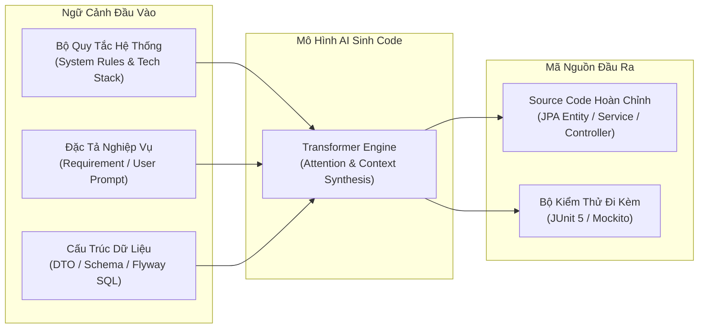
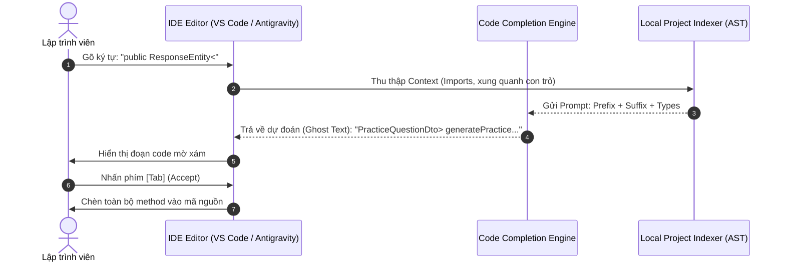
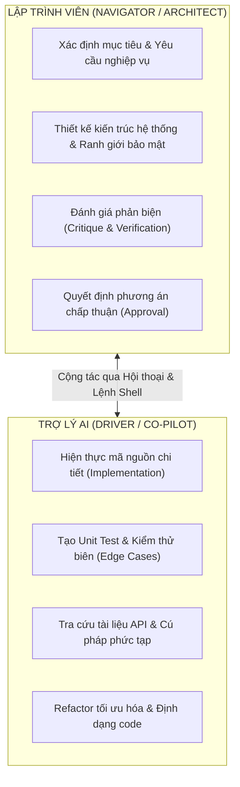
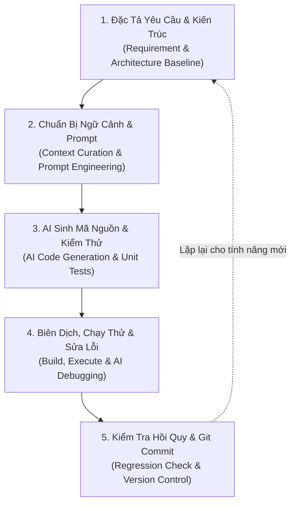

# Chương 6: AI Lập trình (AI-Assisted Software Programming)
> **Dự án:** NihongoAI (Hệ thống Học Tiếng Nhật & Ôn Thẻ FSRS Hỗ Trợ AI)  
> **Tài liệu:** Báo cáo Lý thuyết & Hướng dẫn Thực hành Lập trình Cùng AI  
> **Phiên bản:** 1.0 — Chuẩn hóa Kỹ nghệ Lập trình Hiện đại kết hợp Trợ lý Trí tuệ Nhân tạo  
> **Trạng thái:** HOÀN THÀNH & ĐÃ KIỂM THỬ (Verified Baseline)

---

## 6.1 AI Sinh Mã nguồn (Code Generation)

### 6.1.1 Nguyên lý Hoạt động của Mô hình Ngôn ngữ Lớn trong Sinh Code
AI sinh mã nguồn (Code Generation) là quá trình các Mô hình Ngôn ngữ Lớn (LLM - Large Language Models) như Google Gemini, OpenAI GPT-4o, Anthropic Claude, hoặc DeepSeek chuyển đổi các yêu cầu bằng ngôn ngữ tự nhiên (hoặc đặc tả kiến trúc) thành các khối mã nguồn hoàn chỉnh, có cú pháp chính xác và tuân thủ các quy tắc thiết kế phần mềm.

Quá trình này dựa trên cơ chế Attention (Transformer architecture), trong đó mô hình dự đoán token tiếp theo dựa trên ngữ cảnh lập trình (Context Window), bao gồm:
1. **System Prompt / Meta Instructions:** Thiết lập vai trò chuyên gia phần mềm, tiêu chuẩn mã nguồn, ranh giới công nghệ (Java 21, Spring Boot 3, TypeScript, UTF-8).
2. **Contextual Retrieval (Kiến trúc & Schema):** Các thông tin cấu trúc dữ liệu, bảng cơ sở dữ liệu SQLite, định dạng JSON DTO mong muốn.
3. **User Prompt & Task Constraints:** Nhiệm vụ cụ thể, điều kiện biên (Edge cases), xử lý ngoại lệ và yêu cầu hiệu năng.



### 6.1.2 Các Kỹ thuật Prompt Engineering trong Sinh Mã nguồn
Để tạo ra mã nguồn chất lượng cao, các kỹ sư phần mềm áp dụng các kỹ thuật sau:

1. **Zero-Shot Code Prompting:** Đưa ra yêu cầu trực tiếp kèm theo kiểu dữ liệu.
   * *Ví dụ:* "Viết interface `AiProvider` trong Java 21 định nghĩa 3 phương thức: `generateExercise`, `evaluateAnswer`, và `chatKaiwa` với các DTO tương ứng."
2. **Few-Shot Code Prompting:** Cung cấp 1-2 mẫu code chuẩn của dự án để AI học theo phong cách lập trình (naming convention, annotation, injection pattern).
   * *Ứng dụng trong NihongoAI:* Cung cấp mẫu `VocabularyRepository` để AI sinh tiếp `GrammarRepository` và `CardRepository`.
3. **Chain-of-Thought (CoT) Code Prompting:** Yêu cầu AI phân tích logic từng bước trước khi viết code (Step-by-step thinking).
   * *Ứng dụng:* Khi sinh thuật toán FSRS (Free Spaced Repetition Scheduler), yêu cầu AI giải thích công thức suy giảm trí nhớ ($R = (1 + t/(9 \cdot S))^{-1}$) trước khi chuyển thành mã Java.
4. **Structured JSON Output Constraints:** Ép buộc LLM trả về cấu trúc JSON nghiêm ngặt thay vì văn bản tự do bằng cách sử dụng `response_mime_type: "application/json"` và JSON Schema (như trong Google Gemini API).

### 6.1.3 Phân tích & So sánh Code Sinh bởi AI vs. Lập trình Truyền thống
| Tiêu chí | Lập trình Truyền thống (Manual Coding) | AI Sinh Mã nguồn (Code Generation) | Giải pháp Kết hợp trong NihongoAI |
| :--- | :--- | :--- | :--- |
| **Tốc độ khởi tạo Boilerplate** | Chậm (gõ tay CRUD, DTO, Mappers, Migrations) | Cực nhanh (chỉ mất vài giây để sinh toàn bộ Entity, Repository, DTO) | Sử dụng AI sinh khung sườn (scaffold) và DTO chuẩn |
| **Tính nhất quán kiến trúc** | Phụ thuộc vào kinh nghiệm cá nhân từng dev | Nhất quán nếu được cung cấp bộ luật (System Rules) rõ ràng | Thiết lập tệp luật `backend-rules.md`, `coding-rules.md` |
| **Khả năng hiểu ngữ cảnh miền** | Rất sâu (hiểu rõ nghiệp vụ tiếng Nhật JLPT) | Có thể bị sai lệch nếu prompt thiếu chi tiết | Bổ sung ví dụ cụ thể về ngữ pháp và từ vựng trong prompt |
| **Bảo mật & Bí mật API** | Dev chủ động giấu key trong env | Có nguy cơ sinh code để lộ API key nếu không kiểm soát | Cấm tuyệt đối AI hard-code secrets; chỉ đọc qua cấu hình |

---

## 6.2 AI Tự động Hoàn thành Mã nguồn (Code Completion)

### 6.2.1 Cơ chế In-Filling và Ghost Text trong IDE Hiện đại
AI Code Completion không chỉ đơn giản là gợi ý từ khóa (IntelliSense dựa trên ngữ pháp ngôn ngữ) mà sử dụng các mô hình chuyên biệt cho mã nguồn (Code LLMs như StarCoder, CodeLlama, Gemini Code Assist).

* **Ghost Text (In-line Suggestion):** Hiển thị đoạn code mờ phía trước con trỏ chuột của lập trình viên, cho phép nhấn `Tab` để chấp nhận toàn bộ hoặc `Ctrl + Right Arrow` để chấp nhận từng từ.
* **Fill-in-the-Middle (FIM):** Mô hình không chỉ đọc từ trên xuống dưới mà đọc đồng thời cả tiền ngữ cảnh (Prefix) và hậu ngữ cảnh (Suffix) để điền chính xác đoạn code còn thiếu ở giữa một hàm.
* **AST Parsing & Local Indexing:** Công cụ AI phân tích cây cú pháp trừu tượng (Abstract Syntax Tree) của workspace để nhận biết các biến, phương thức và thư viện hiện hành.



### 6.2.2 Ứng dụng Code Completion trong Dự án NihongoAI
1. **Tầng Backend (Spring Boot):**
   * Tự động hoàn thành các câu lệnh truy vấn Derived Query trong Spring Data: `findByJlptLevel(String level)`, `findByDeckIdAndDueDateBefore(...)`.
   * Tự động sinh constructor injection tuân thủ quy tắc không dùng `@Autowired` trên field:
     ```java
     // Gõ 'public PracticeService(' -> AI tự động hoàn thành:
     public PracticeService(
             AiProviderFactory aiProviderFactory,
             VocabularyRepository vocabularyRepository,
             GrammarRepository grammarRepository
     ) {
         this.aiProviderFactory = aiProviderFactory;
         this.vocabularyRepository = vocabularyRepository;
         this.grammarRepository = grammarRepository;
     }
     ```
2. **Tầng Frontend (React + TypeScript):**
   * Tự động hoàn thành các props interface và destructuring cho component.
   * Gợi ý Tailwind CSS classes hoặc biến màu CSS Design System theo đúng quy chuẩn Kyoto Tactile Studio (`var(--kyoto-surface)`, `var(--kyoto-vermilion)`).

---

## 6.3 AI Sửa lỗi (Debugging)

### 6.3.1 Phương pháp Chẩn đoán Lỗi với AI (Log Trace & Root Cause Analysis)
Khi xảy ra lỗi biên dịch (Compilation Error) hoặc lỗi thực thi (Runtime Exception), lập trình viên cung cấp:
1. **Stack trace đầy đủ** (không cắt xén thông tin lỗi gốc).
2. **Đoạn mã nguồn liên quan trực tiếp.**
3. **Môi trường thực thi** (Hệ điều hành, phiên bản JDK, hệ quản trị CSDL).

Quy trình suy luận của AI khi sửa lỗi:
* **Bước 1: Phân tích mã lỗi (Error Signature):** Nhận diện kiểu ngoại lệ (`SQLException`, `SchemaManagementException`, `PortAlreadyInUseException`).
* **Bước 2: Truy tìm nguyên nhân gốc rễ (Root Cause):** Phân biệt giữa triệu chứng bề ngoài và lỗi bản chất (ví dụ: lỗi type casting giữa SQLite dynamic type và Hibernate dialect).
* **Bước 3: Đánh giá tác động hồi quy (Regression Check):** Đảm bảo bản vá sửa dứt điểm lỗi mà không làm hỏng các tính năng hiện có.
* **Bước 4: Đề xuất phương án tối ưu:** Cung cấp diff chính xác kèm giải thích nguyên nhân.

### 6.3.2 Các Case Study Sửa Lỗi Thực Tế trong NihongoAI
Dưới đây là 3 trường hợp sửa lỗi kinh điển được thực hiện thành công nhờ AI trong dự án:

#### Case 1: Lỗi Xung đột Kiểu Dữ liệu SQLite vs. Hibernate 6 (`SchemaManagementException`)
* **Hiện tượng:** Khi chạy ứng dụng với `hibernate.ddl-auto: validate`, Spring Boot văng lỗi:
  ```
  SchemaManagementException: wrong column type encountered in column [id] in table [card]; found [integer], but expecting [bigint]
  ```
* **Chẩn đoán bằng AI:** SQLite sử dụng cơ chế Dynamic Typing, kiểu `INTEGER` trong SQLite tự động mở rộng từ 1 đến 8 bytes (64-bit). Tuy nhiên, Hibernate 6 ORM kiểm tra dialect cứng nhắc và kỳ vọng cột `BIGINT` cho thuộc tính `Long` trong Java.
* **Giải pháp khắc phục:** Chuyển `spring.jpa.hibernate.ddl-auto: none` vì dự án đã có Flyway Migration đảm bảo toàn vẹn schema 100%, tránh Hibernate can thiệp sai lệch vào SQLite.

#### Case 2: Lỗi Tiến trình Zombie chiếm giữ Cổng 8088 trên Windows
* **Hiện tượng:** Khi khởi động lại ứng dụng, báo lỗi:
  ```
  APPLICATION FAILED TO START
  Description: Web server failed to start. Port 8088 was already in use.
  ```
* **Chẩn đoán bằng AI:** Quá trình Maven build trước đó bị ngắt nhưng tiến trình con Java (child process) vẫn chạy nền ngầm (orphan process) và tiếp tục lắng nghe trên socket 8088.
* **Giải pháp khắc phục:** AI cung cấp câu lệnh PowerShell truy xuất chính xác Process ID qua `Get-NetTCPConnection` và tiêu diệt an toàn:
  ```powershell
  $pidToKill = (Get-NetTCPConnection -LocalPort 8088).OwningProcess
  Stop-Process -Id $pidToKill -Force
  ```

#### Case 3: Lỗi Mã hóa Ký tự Tiếng Nhật & Tiếng Việt (Encoding Corruption)
* **Hiện tượng:** Dữ liệu tiếng Nhật Kanji và dấu tiếng Việt bị biến thành ký tự rác `???` khi gửi qua giao tiếp CLI.
* **Chẩn đoán bằng AI:** Console PowerShell mặc định dùng codepage hệ thống (Windows-1252 hoặc CP437), không tự động chuyển đổi UTF-8 cho luồng `Invoke-RestMethod`.
* **Giải pháp khắc phục:** Cấu hình rõ `[Console]::OutputEncoding = [System.Text.Encoding]::UTF8` và đặt header `Content-Type: application/json; charset=utf-8` trong request body.

---

## 6.4 Lập trình Cặp cùng AI (AI Pair Programming)

### 6.4.1 Mô hình Phân chia Vai trò: Driver vs. Navigator
Lập trình cặp cùng AI tái định nghĩa mô hình Pair Programming truyền thống:



* **Con người (Navigator):** Giữ bức tranh toàn cảnh, chịu trách nhiệm về tính đúng đắn logic học tiếng Nhật, an toàn dữ liệu người dùng và thiết kế trải nghiệm người dùng (UX).
* **AI (Driver):** Thực hiện chi tiết việc gõ code, tạo mẫu code nhanh, chuyển đổi cấu trúc JSON, viết regex, và tự động hóa các bước kiểm thử lặp đi lặp lại.

### 6.4.2 Quy tắc Phản biện và Kiểm soát Chất lượng (Review Protocols)
1. **Không tin tưởng tuyệt đối (Zero Trust):** Mọi dòng code do AI sinh ra phải được biên dịch (`mvn compile`, `npm run build`) và chạy qua bộ kiểm thử tự động (`mvn test`) trước khi hòa nhập.
2. **Bảo tồn tính toàn vẹn (Documentation Integrity):** Giữ nguyên các chú thích có sẵn; bổ sung comment giải thích lý do (WHY) thay vì diễn giải lại code (WHAT).
3. **Giới hạn phạm vi tác động (Scope Control):** Yêu cầu AI chỉ sửa đúng tệp tin và hàm cần xử lý, không được tự ý đổi tên tệp hay format lại các mô-đun không liên quan.

---

## 6.5 Quy trình Lập trình cùng AI (AI-Assisted SDLC)

Quy trình phát triển phần mềm được chuẩn hóa thành 5 giai đoạn liên tục:



### Các Bước Thực Hiện Cụ Thể:
1. **Giai đoạn 1: Đặc tả Yêu cầu (Specification):** Viết tài liệu mô tả rõ Input, Output, API Endpoint, Entity Model và các ràng buộc bảo mật.
2. **Giai đoạn 2: Chuẩn bị Ngữ cảnh (Context Curation):** Cung cấp cho AI schema hiện tại, các interface liên quan và quy tắc code (`backend-rules.md`, `ai-rules.md`).
3. **Giai đoạn 3: Sinh Mã nguồn (Generation):** Yêu cầu AI sinh code kèm theo Unit Test độc lập.
4. **Giai đoạn 4: Thẩm định & Sửa lỗi (Verification & Debug):** Chạy `mvn test`, kiểm tra kết quả thực tế. Nếu phát sinh lỗi, đưa log trace cho AI phân tích root cause và sửa đổi ngay.
5. **Giai đoạn 5: Đóng gói & Commit (Version Control):** Thực hiện commit có ý nghĩa theo chuẩn Conventional Commits (`feat:`, `fix:`, `docs:`) và đồng bộ lên remote Git repository.

---

## Bài thực hành 6: Demo Ví dụ Minh họa (Practical Implementation)

### Mục Tiêu Thực Hành
Hiện thực hóa **Google Gemini AI Provider thực tế (`GeminiAiProvider`)** trong Spring Boot của dự án NihongoAI, chuyển đổi từ mô hình giả lập (Mock) sang kết nối trực tiếp với API Google Gemini:
1. Sử dụng Spring `RestClient` kết nối tới endpoint Google Gemini 1.5 Flash (`generateContent`).
2. Tích hợp Structured Output (JSON Schema) để AI trả về đúng định dạng DTO cho bài luyện dịch và đánh giá câu trả lời.
3. Cơ chế Graceful Fallback: Tự động chuyển về `LocalMockAiProvider` nếu thiếu API Key hoặc lỗi mạng, đảm bảo hệ thống không bao giờ bị dừng hoạt động (crash-proof).
4. Viết Unit Test và kiểm thử End-to-End gọi qua REST API.

---
*Tài liệu thuộc khuôn khổ đồ án môn học — Dự án NihongoAI.*
