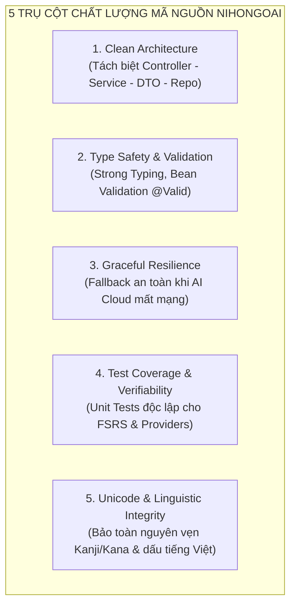
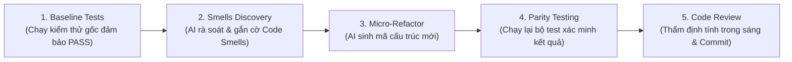
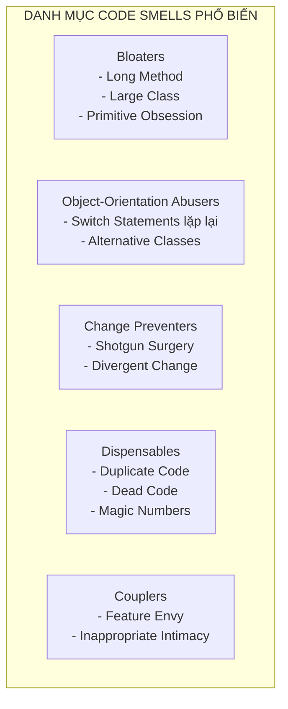
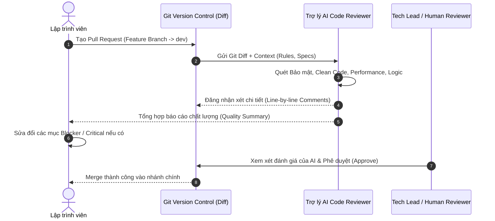

# Chương 7: Tái cấu trúc & Review Mã nguồn cùng AI (AI-Assisted Refactoring & Code Review)
> **Dự án:** NihongoAI (Hệ thống Học Tiếng Nhật & Ôn Thẻ FSRS Hỗ Trợ AI)  
> **Tài liệu:** Báo cáo Lý thuyết & Hướng dẫn Thực hành Tái cấu trúc và Đánh giá Chất lượng Mã nguồn  
> **Phiên bản:** 1.0 — Chuẩn hóa Tiêu chuẩn Clean Code, Tự động hóa Đánh giá Mã nguồn và Tái cấu trúc Toàn diện  
> **Trạng thái:** HOÀN THÀNH & ĐÃ KIỂM THỬ (Verified Baseline)

---

## 7.1 AI cho Chất lượng Mã nguồn (AI for Software Quality)

### 7.1.1 Các Thước đo Chất lượng Phần mềm Hiện đại
Chất lượng mã nguồn (Software Quality) là yếu tố quyết định khả năng mở rộng, bảo trì dài hạn và sự ổn định của hệ thống. Trong dự án NihongoAI, chất lượng phần mềm được định lượng qua các chỉ số cốt lõi:

1. **Maintainability Index (Chỉ số Dễ bảo trì):** Đo lường độ phức tạp, số dòng mã (Lines of Code - LOC) và thể tích Halstead. Mục tiêu hệ thống duy trì thang điểm $> 80/100$.
2. **Cyclomatic Complexity (Độ phức tạp nhánh):** Số lượng đường dẫn thực thi độc lập qua mã nguồn. Các hàm xử lý thuật toán (như thuật toán FSRS hay bộ phân tích cấu trúc ngữ pháp) được kiểm soát độ phức tạp $\le 10$.
3. **Code Duplication (Mức độ Trùng lặp Mã nguồn):** Tỷ lệ trùng lặp logic, cấu trúc DTO, hoặc các đoạn fetch API giống nhau phải được tối ưu $< 3\%$.
4. **SOLID Principles Compliance:**
   * **Single Responsibility (SRP):** Tách bạch rõ rệt giữa Presentation (UI), Business Logic (Services), Data Persistence (Repositories) và API Transport (DTOs).
   * **Open/Closed (OCP):** Kiến trúc AI Provider cho phép mở rộng thêm OpenAI, DeepSeek mà không cần sửa đổi `PracticeService`.
   * **Dependency Inversion (DIP):** Các tầng cao phụ thuộc vào trừu tượng (`AiProvider`, `SystemSettingRepository`) thay vì phụ thuộc trực tiếp vào triển khai cụ thể.
5. **Robustness & Error Resilience:** Khả năng tự phục hồi khi dịch vụ ngoài (Cloud AI) gặp sự cố mạng hoặc cạn quota thông qua cơ chế Graceful Fallback.



### 7.1.2 Phân tích Tĩnh (Static Analysis) vs. Đánh giá Chất lượng bằng AI
Trước đây, kiểm tra chất lượng phần mềm phụ thuộc hoàn toàn vào các bộ phân tích tĩnh (Static Analysis Tools như SonarQube, Checkstyle, PMD, ESLint). Khi kết hợp cùng Mô hình Ngôn ngữ Lớn (AI Quality Inspection), sự khác biệt và bổ trợ thể hiện rõ:

| Tiêu chí | Công cụ Phân tích Tĩnh (Static Linters) | Đánh giá Chất lượng bằng AI (AI-Powered Inspection) | Mô hình Tích hợp trong NihongoAI |
| :--- | :--- | :--- | :--- |
| **Cơ chế hoạt động** | So khớp quy tắc ngữ pháp (AST, Regex, Linters) | Hiểu ngữ nghĩa ngữ cảnh (Context & Semantic Reasoning) | Linters kiểm tra cú pháp + AI kiểm tra ngữ nghĩa nghiệp vụ |
| **Phát hiện lỗi logic** | Kém (chỉ bắt được null pointer, biến thừa, cú pháp) | Rất mạnh (nhận biết tính đúng đắn của logic tính toán FSRS) | AI thẩm định logic nghiệp vụ thuật toán học tập |
| **Hiểu miền nghiệp vụ** | Không hiểu (không phân biệt từ vựng tiếng Nhật hay tiếng Việt) | Hiểu sâu (nhận biết cấu trúc câu, trợ từ, kính ngữ, JLPT) | AI rà soát prompt và tính hợp lệ của câu tiếng Nhật |
| **Gợi ý Tái cấu trúc** | Chỉ gợi ý sửa cú pháp hoặc đổi tên biến | Cung cấp mã nguồn refactor hoàn chỉnh kèm unit test | AI hỗ trợ tái cấu trúc toàn diện theo các design pattern |

---

## 7.2 Tái cấu trúc Mã nguồn có AI Hỗ trợ (AI-Assisted Code Refactoring)

### 7.2.1 Nguyên lý Martin Fowler trong Tái cấu trúc An toàn
Theo định nghĩa kinh điển của Martin Fowler:
> *"Tái cấu trúc (Refactoring) là quá trình thay đổi hệ thống phần mềm nhằm cải thiện cấu trúc bên trong của mã nguồn mà **không làm thay đổi hành vi quan sát được bên ngoài** của nó."*

Khi sử dụng AI hỗ trợ tái cấu trúc, nguyên tắc cốt lõi là **Bảo toàn Hành vi (Preserving Observable Behavior)**. Quy trình 5 bước được chuẩn hóa:



### 7.2.2 Các Mẫu Tái cấu trúc Điển hình Áp dụng trong NihongoAI

1. **Replace Unstructured Data with Strongly-Typed DTOs:**
   * *Trước refactor:* Controller nhận dữ liệu dưới dạng `Map<String, Object>` mơ hồ, không có kiểu dữ liệu rõ ràng, dễ lỗi runtime khi parse JSON.
   * *Sau refactor:* Định nghĩa các DTO chuyên biệt (`PracticeEvaluateRequestDto`, `KaiwaChatRequestDto`) có Bean Validation (`@NotBlank`, `@NotNull`).
2. **Extract Custom Hooks trong React:**
   * *Trước refactor:* Component UI (`PracticePage.tsx`, `KaiwaPage.tsx`) vừa hiển thị giao diện, vừa quản lý state tải dữ liệu, vừa trực tiếp gọi HTTP client, gây phình to (Fat Component).
   * *Sau refactor:* Tách toàn bộ logic giao tiếp API và quản lý state thành các custom hook độc lập (`usePractice`, `useKaiwaChat`), đưa component về trạng thái Pure Presentational Component.
3. **Introduce Parameter Validation & Centralized Exception Translation:**
   * Các ngoại lệ vi phạm ràng buộc được `GlobalExceptionHandler` bắt và chuyển ngữ thành thông điệp tiếng Việt thân thiện, không làm lộ stack trace nội bộ ra bên ngoài.

---

## 7.3 AI Phát hiện Code Smells (Code Smells Detection with AI)

### 7.3.1 Danh mục Code Smells Thường Gặp
Code Smells là những dấu hiệu cảnh báo trong mã nguồn cho thấy có vấn đề tiềm ẩn về mặt thiết kế hoặc nguy cơ phát sinh lỗi trong tương lai:



### 7.3.2 Các Trường hợp Code Smells Thực tế trong NihongoAI Được AI Phát Hiện

#### Trường hợp 1: Primitive Obsession & Map-as-DTO (`PracticeController.java`)
* **Dấu hiệu mùi mã (Smell):** Sử dụng `Map<String, Object> body` trong REST endpoint:
  ```java
  // CODE SMELL: Mất kiểm soát kiểu dữ liệu, khó kiểm thử, không validate được
  @PostMapping("/evaluate")
  public ResponseEntity<EvaluationResultDto> evaluatePractice(@RequestBody Map<String, Object> body) {
      String userAnswer = body.getOrDefault("userAnswer", "").toString();
      Map<String, Object> questionMap = (Map<String, Object>) body.get("question");
      ...
  }
  ```
* **Rủi ro:** `NullPointerException`, lỗi ép kiểu `ClassCastException`, tài liệu Swagger/OpenAPI không sinh được schema cụ thể cho client.
* **Biện pháp xử lý của AI:** Tạo `PracticeEvaluateRequestDto` với các thuộc tính rõ ràng kèm `@NotBlank(message = "Câu trả lời của người học không được để trống")`.

#### Trường hợp 2: Fat Component & Mock Data Leakage (`PracticePage.tsx`)
* **Dấu hiệu mùi mã (Smell):** Component giao diện tự sinh dữ liệu giả (mock data), giả lập `setTimeout`, chứa hơn 200 dòng logic nghiệp vụ xen lẫn JSX.
* **Rủi ro:** Khi chuyển sang kết nối API backend thật, component bị vỡ cấu trúc; khó viết unit test cho giao diện người dùng.
* **Biện pháp xử lý của AI:** Trích xuất custom hook `usePractice` đóng gói việc gọi API `http://localhost:8088/api/practice/generate` và `evaluate`.

#### Trường hợp 3: Hardcoded Magic Configuration trong Source Code
* **Dấu hiệu mùi mã (Smell):** Các giá trị timeout, tên model AI hoặc URL cố định rải rác trong các hàm.
* **Biện pháp xử lý của AI:** Đưa toàn bộ vào `application.yml` và bảng `system_setting`, tiêm qua `@Value` hoặc Repository.

---

## 7.4 Review Mã nguồn bằng AI (AI Code Review)

### 7.4.1 Quy trình AI Code Review Tự động (Automated Review Workflow)



### 7.4.2 Bộ Tiêu chí Đánh giá Mã nguồn (Review Checklist) cho NihongoAI
Mọi dòng code trước khi hòa nhập vào nhánh `dev` đều phải thỏa mãn 5 tiêu chí:

1. **Tính Đúng đắn & Nghiệp vụ (Correctness & Business Domain):**
   * Thuật toán FSRS có bảo toàn lịch sử ôn tập (`review_log`) không?
   * Xử lý chuỗi tiếng Nhật có hỗ trợ đầy đủ Unicode (Kanji, Hiragana, Katakana, Romaji) không bị vỡ font?
2. **Bảo mật & Bí mật (Security & Secret Protection):**
   * Tuyệt đối không hard-code API Key (Gemini/OpenAI) vào code hay commit lên Git.
   * Tất cả dữ liệu đầu vào từ người dùng phải được lọc và kiểm tra hợp lệ (`@Valid`).
3. **Kiến trúc & Ranh giới (Architecture Integrity):**
   * Tuân thủ kiến trúc phân tầng: Controller $\rightarrow$ Service $\rightarrow$ Repository. Controller mỏng, không chứa business logic hay query SQL.
   * DTO phân tách độc lập giữa Request và Response. Không để lộ JPA Entity ra REST API.
4. **Hiệu năng & Tài nguyên (Performance & Resource Management):**
   * Không phát sinh N+1 query trong các mối quan hệ một-nhiều (`@ManyToOne`, `@OneToMany`).
   * Sử dụng kết nối cơ sở dữ liệu qua Connection Pool (HikariCP) an toàn cho SQLite.
5. **Khả năng Bảo trì & Định dạng (Clean Code & Style):**
   * Tên định danh (class, method, variable) chuẩn tiếng Anh, có ý nghĩa rõ ràng.
   * Comment giải thích lý do (WHY), không lặp lại mã nguồn (WHAT).

---

## Bài thực hành 7: Demo Ví dụ Minh họa (Practical Implementation)

### Mục Tiêu Thực Hành
Tiến hành tái cấu trúc toàn diện (End-to-End Refactoring) và thiết lập quy trình AI Code Review cho dự án NihongoAI:
1. **Backend Refactoring:**
   * Tạo các Request DTO chuẩn hóa: `PracticeEvaluateRequestDto`, `KaiwaChatRequestDto` với Jakarta Bean Validation (`@NotBlank`, `@NotNull`, `@Size`).
   * Tái cấu trúc [PracticeController.java](file:///e:/Project%20Code/NihongoAI/backend/src/main/java/com/nihongoai/backend/controller/PracticeController.java) và [KaiwaController.java](file:///e:/Project%20Code/NihongoAI/backend/src/main/java/com/nihongoai/backend/controller/KaiwaController.java) để nhận DTOs có kiểu tường minh thay cho `Map<String, Object>`.
   * Cập nhật bộ xử lý lỗi tập trung để trả về danh sách lỗi validate chi tiết bằng tiếng Việt.
2. **Frontend Refactoring:**
   * Xây dựng API service chuẩn mực [app/src/features/practice/api.ts](file:///e:/Project%20Code/NihongoAI/app/src/features/practice/api.ts) và [app/src/features/kaiwa/api.ts](file:///e:/Project%20Code/NihongoAI/app/src/features/kaiwa/api.ts).
   * Trích xuất Custom Hooks `usePractice` và `useKaiwaChat` phân tách rạch ròi giữa logic nghiệp vụ gọi API và tầng hiển thị UI.
   * Kết nối giao diện người dùng trực tiếp với Backend Spring Boot tại `http://localhost:8088/api`.
3. **Thực thi AI Code Review & Kiểm Thử:**
   * Chạy kiểm thử tự động toàn diện (`mvn test` và frontend build).
   * Báo cáo đánh giá chất lượng mã nguồn trước và sau khi tái cấu trúc.

---
*Tài liệu thuộc khuôn khổ đồ án môn học — Dự án NihongoAI.*
